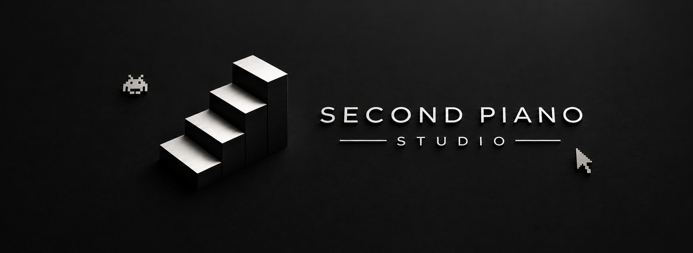

 SECONDOPIANOSTUDIO

**A small independent studio crafting retro arcade space shooters.**
*Secondo Piano* — "second floor" — the floor above, where the arcade lives.

---

 Our Games

<table>
<tr>
<td width="50%" valign="top">

 🕹 Cursor Shooter II

**A fast-paced 16-bit inspired vertical shoot 'em up.** Pilot your fighter
through five dangerous space sectors full of enemy formations, bullet-hell
waves, power-ups and massive bosses — all the way to the final battle against
the **Omega Cursor**.

[ ▶ Play in browser ](https://secondopianostudio.itch.io/cursor-shooterii) · [ 🌐 Game page ](https://secondopianostudio.itch.io/cursor-shooterii) · [ ❤ Support ](https://secondopianostudio.itch.io/cursor-shooterii/donate)**

`vertical shmup` `boss fights` `power-ups` `high scores`

</td>
<td width="50%" valign="top">

 🕹 Cursor Shooter

**Old-school arcade action with retro pixel vibes.** You fly around, shoot
asteroids, try not to die, and rack up the highest score you can. Simple, a bit
addictive, and perfect for a quick session.

**[ ▶ Play in browser ](https://secondopianostudio.itch.io/cursor-shooter) · [ 🌐 Game page ](https://secondopianostudio.itch.io/cursor-shooter) · [ ❤ Support ](https://secondopianostudio.itch.io/cursor-shooter/donate)**

`asteroids` `survival` `high scores` `local co-op`

</td>
</tr>
</table>

---

 What we're about

- **Retro first** — pixel-art visuals and arcade-style sound effects
- **Instant play** — every game runs directly in your browser, free to play
- **Player friendly** — keyboard & mouse support, high scores, and regular updates

---

 Play free in the browser:** [Cursor Shooter II](https://secondopianostudio.itch.io/cursor-shooterii) · [Cursor Shooter](https://secondopianostudio.itch.io/cursor-shooter)

*( — arcade from the second floor, since 2025 — )*

